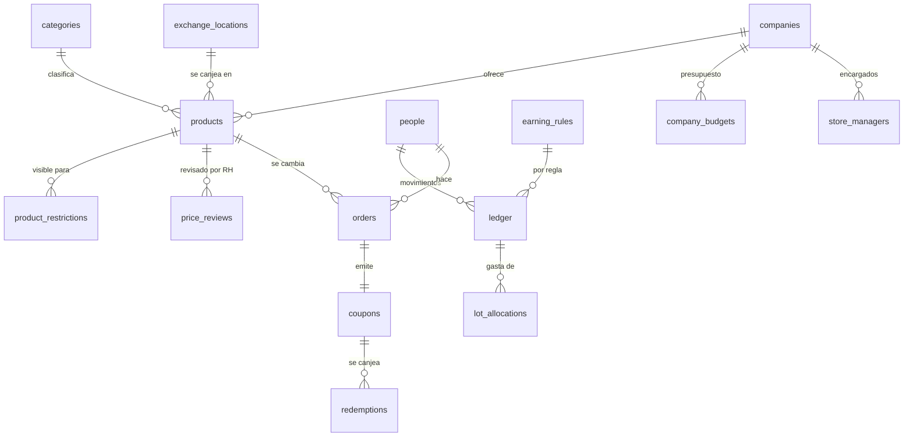

# Base de datos · El Trueque

El esquema vive en `supabase/migrations/20261103000000_trueque_init.sql`, dentro del esquema de Postgres **`trueque`**, en la **misma base que Chispa**. Los catálogos y las reglas de ganancia están en `supabase/seed.sql` y el ejemplo en `supabase/seed_demo.sql`. La prueba `supabase/tests/schema_check.mjs` levanta un Postgres en memoria (PGlite), aplica Chispa y El Trueque juntos y comprueba 32 reglas.

## Por qué un esquema por app

| Esquema | Dueño | Qué guarda |
|---|---|---|
| `public` | Chispa | Lo común del ecosistema: `companies`, `areas`, `departments`, `people`, la sesión (`current_person_id()`), y lo propio de Chispa (retos, chispas). |
| `trueque` | El Trueque | Productos, cacaos, trueques y cupones. |
| `custodia` | Custodia | Inventario y resguardos. |

Cada app escribe sólo en su esquema y **lee** lo común. Se hablan por eventos con folio (`CHI-012` llegó a la feria → abona cacaos) y no compartiendo tablas. En SQL Server se traduce tal cual a esquemas (`trueque.products`), y cada API puede vivir aparte.

## El mapa

## Espejo del sistema de cupones existente

El grupo ya opera un sistema de cupones (plantillas, cupones asignados a la persona, historial de canjes, lugares de canje y restricciones por empresa, área y departamento). El Trueque **no inventa otro**: sus tablas guardan las mismas columnas para que en la fase 2 el trueque emita el cupón ahí.

| El Trueque | Equivale a | Columnas que espejan |
|---|---|---|
| `products` | La plantilla del cupón | título, descripción, tipo, días de vigencia (`coupon_days`), canjes (`swaps`), presupuesto y moneda (`budget_amount`, `currency`), tipo de código (`code_type`: QR, barras, texto), vigencia de publicación (`available_from/until`), imagen, activo |
| `coupons` | El cupón asignado a la persona | código, canjes disponibles y usados, presupuesto y usado, estado (`valid`, `expired`, `disabled`, `used`), vigencia, fecha de asignación, origen |
| `redemptions` | El historial de canjes | canjes y monto restantes en cada canje, quién y cuándo |
| `exchange_locations` | Los lugares de canje | nombre, ciudad, estado, dirección, referencia, imagen, correo, usuario que atiende |
| `product_restrictions` | La restricción de reparto | empresa, área, departamento |

Las llaves `rh_coupon_key`, `rh_book_key` y `rh_key` guardan la clave del registro en el sistema existente cuando se sincronice.

## Las tablas y por qué

### Productos

| Tabla | Por qué así |
|---|---|
| `products` | Lo publica una **empresa** (`company_id`), que es quien paga. `status` empieza en `pending`: la empresa no puede ponerlo `live`, sólo RH con `review_price()`. `stock` nulo = sin límite (servicios). `origin`/`origin_ref` dicen si vino de Custodia (`custodia`, `EQ-0412`); un índice único impide postular dos veces el mismo equipo. Folio `PRD-0000` con contador. |
| `categories` | Servicios, artículos, de Custodia, con su **rango de precio de referencia** (`price_min`, `price_max`) que RH usa para mantener precios parejos. |
| `product_restrictions` | Si no hay filas, el producto es para la gente de la empresa que lo ofrece. Si las hay, sólo para esas empresas, áreas o departamentos. La llave compuesta `(department_id, area_id)` impide un departamento de otra área, como en Chispa. |
| `price_reviews` | Cada decisión de RH (aprobado, ajustado con precio final, rechazado) con quién y cuándo. |
| `exchange_locations` | Dónde se entrega; `attendant_id` es quien canjea ahí. |

### El libro de cacaos

| Tabla | Por qué así |
|---|---|
| `ledger` | **El saldo nunca se guarda: se calcula.** Cada movimiento es una fila inmutable (`earn`, `spend`, `expire`, `refund`, `adjust`); un trigger impide editar o borrar. Cada ganancia es un **lote** con su `expires_on` (12 meses, configurable en `config.lot_months`). `company_id` es la empresa de la persona en ese momento: si cambia de empresa, su historia no se reescribe. El índice único `(person_id, rule_code, source_id)` hace que **la misma chispa no pague dos veces la misma regla**, aunque el estado vaya y venga. |
| `lot_allocations` | Qué lote pagó cada gasto: el FIFO queda auditado (se gastan primero los que vencen antes). La caducidad también se registra como asignación. |
| `earning_rules` | Qué paga cuánto y con qué tope al mes. Hoy sólo Chispa (`source = 'chispa'`); capacitación o encuestas son filas nuevas. |
| `config` | Una sola fila: meses de vigencia del lote y si se devuelven cacaos de cupones vencidos. |

### Trueques y presupuesto

| Tabla | Por qué así |
|---|---|
| `orders` | El trueque: persona, producto, precio pagado (congelado), la empresa que paga y el movimiento del libro (`spend_id`, único). Folio `TRQ-0000`. |
| `coupons` | Uno por trueque, con código único `CAC-…`. Vigencia = `coupon_days` del producto. `check` de canjes y montos. |
| `redemptions` | Cada canje con lo que queda. |
| `company_budgets` | Cacaos asignados por empresa y año. `trade()` no deja pasar si la empresa ya lo usó. |
| `store_managers`, `hr_reviewers` | Los roles: encargados de la tienda por empresa y RH corporativo. El colaborador no se guarda: es cualquiera. |

## Lecturas preparadas (vistas)

| Vista | Para qué |
|---|---|
| `lots` | Cada lote con lo que le queda. |
| `balances` | Saldo vigente y cacaos por vencer en 60 días, por persona. |
| `product_cards` | Lo que lee el mercado, con `stock_left` y folio formateado. |
| `budget_usage` | Por empresa y año: asignado, canjeado, comprometido en cupones vigentes y disponible. |

## Lo que hace la base sola

- **Abona cacaos desde Chispa** con triggers sobre `public.ideas` y `public.challenges`: chispa recibida (5, tope 4 al mes), pasa a revisión (10), llega a la feria (60), se implementa (150), reto publicado o sugerido y aceptado (15, tope 2 al mes, a quien lo sugirió). Avivar no paga.
- Asigna folios de producto y de trueque.
- Impide editar el libro.

## Operaciones (funciones)

| Función | Quién | Qué hace |
|---|---|---|
| `trueque.trade(producto)` | Colaborador | En una transacción: valida que esté vivo, visible, en fechas y con existencias; que alcance el saldo y el presupuesto de la empresa; registra el gasto, reparte los lotes FIFO, crea el trueque y el cupón. Devuelve folio, código y saldo. |
| `trueque.redeem(código, lugar, monto)` | Lugar de canje o empresa | Canjea, descuenta canjes/monto y cierra el trueque al agotarse. |
| `trueque.review_price(producto, decisión, precio, nota)` | RH | Aprueba, ajusta o rechaza; publica o no. |
| `trueque.create_product_from_asset(…)` | Sólo otras apps (Custodia) | Producto pendiente con existencias 1 y origen `custodia`. No se puede llamar desde el cliente. |
| `trueque.expire_lots()`, `trueque.expire_coupons()` | `pg_cron` diario | Registran la caducidad en el libro y en los cupones. |

## Seguridad (RLS)

- El colaborador ve sólo los productos **vivos** que le tocan, y sólo **su** libro, trueques y cupones.
- La empresa ve y edita sus productos (nunca los publica ella misma), ve los trueques de sus productos y su presupuesto.
- RH ve todo y es el único que publica precios y asigna presupuestos.
- Nadie escribe en el libro, ni en trueques o cupones, salvo por las funciones.

## Paso a SQL Server (fase 2)

| Postgres | SQL Server |
|---|---|
| esquema `trueque` | esquema `trueque` |
| `uuid`, `timestamptz`, `text + check` | `uniqueidentifier`, `datetimeoffset`, `nvarchar + CHECK` |
| `bigint generated always as identity` | `bigint IDENTITY` |
| Índices únicos parciales | Índices filtrados (`WHERE kind = 'earn'`) |
| Triggers desde Chispa | Eventos del dominio en el API (MediatR) |
| `trade()`, `redeem()` | Comandos con transacción en Application |
| RLS | `[Authorize]` y validadores en el API |

## Cómo escala

- **Más fuentes de cacaos:** filas en `earning_rules` y un trigger o evento por fuente.
- **Más empresas:** cada una con sus encargados, presupuesto y lugares; los precios se mantienen parejos con las categorías.
- **Millones de movimientos:** el saldo sale de lotes con índice por persona y vencimiento; si hiciera falta, una vista materializada de saldos se agrega sin tocar las tablas.
- **Auditoría completa:** el libro es inmutable y cada gasto dice de qué lote salió.

## Fase 1.1 · `20261104000000_trueque_store_v2.sql`

Completa la tienda con lo aprobado en la propuesta v0.3.0. Se corre después de `trueque_init.sql` y de las semillas; convierte también los datos existentes.

| Cambio | Por qué |
|---|---|
| `config.cacao_value` (pesos por cacao, 5 por omisión) | Una sola equivalencia para sugerir precios y mostrar costos. RH la cambia desde Ajustes. |
| `earning_rules.note`, `is_variable`, fuente `insignias` y `rh`, regla `badge` | Las reglas se explican solas y aceptan fuentes nuevas sin tocar código; la insignia paga lo que valga. |
| `products.cost`, `includes`, `stall` | El costo real en pesos es lo que se descuenta del presupuesto; lo que incluye y el color del toldo se ven en el mercado. Los productos existentes toman `price × cacao_value` como costo. |
| `orders.cost` | Congela el costo al momento del trueque, para que un cambio de precio no mueva lo ya comprometido. |
| `product_images` (hasta 2, base64 ≤ 300 KB) | Fotos sin configurar Storage; en tabla aparte para que el mercado sólo cargue la primera. |
| `company_budgets.assigned` en pesos y `budget_usage` por **empresa que ofrece** | Decisión aprobada: paga quien ofrece, con el costo real. Lo asignado existente se multiplica por `cacao_value`. |
| `trade()` revisa el presupuesto de quien ofrece contra el costo | Si esa empresa ya no tiene presupuesto, no hay trueque. |
| `coupon_lookup()` | El encargado ve el cupón (persona, vigencia, costo) antes de canjear; un colaborador no ve cupones ajenos. |
| `redeem()` con mensajes por caso | No existe, de otro puesto, ya se usó, ya venció. |
| `review_price()` exige motivo al ajustar o rechazar y precio dentro del rango | La empresa entiende la decisión y el precio queda parejo. |
| Trigger `guard_product` | La empresa edita el texto sin salir del mercado; si cambia precio, costo o categoría vuelve a revisión; sólo RH publica; pausar y reanudar es suyo. |
| Políticas de RH en `config`, `earning_rules`, `categories`, `exchange_locations`; trigger `guard_budget` | Ajustes desde pantalla; un presupuesto no baja de lo ya usado. |
| `notifications` + triggers `notify_earn`, `notify_review`; función `notify_expiring()` | Avisos de cacaos ganados y decisiones de RH al momento; los de vencimiento con la tarea diaria. |
| Vistas `dashboard_*` | Tablero de RH: totales, meses, áreas, fuentes y lo más cambiado. |

Mantenimiento diario con `pg_cron`: `select trueque.expire_lots(); select trueque.expire_coupons(); select trueque.notify_expiring();`.

Prueba PGlite: 49 reglas en verde (las 32 de antes más 17 de esta fase); la de Custodia sigue en verde (30).

### Toldo por ilustración y aviso a RH (`20261104010000_trueque_stall_defaults.sql`)

- `trueque.default_stall(art, origin)` da el color del toldo según la ilustración (comida achiote, salud nopal, aprendizaje y Custodia cacao…). Los productos que existían antes de la columna `stall` quedaron todos en `grana`; la migración los acomoda y `seed_demo.sql` la usa para sus productos.
- `trueque.notify_pending()` avisa en la campana a cada persona de `hr_reviewers` cuando un producto entra o regresa a `pending` (alta nueva o cambio de precio, costo o categoría). No avisa a quien lo publicó si también es RH.
